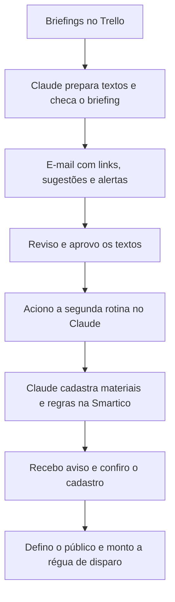

# Automação de campanhas de CRM com Claude

**Contexto** · Bet Dá Sorte · Operação de CRM  
**Ferramentas** · Claude, Trello, e-mail e Smartico

Na preparação de cada campanha, a equipe precisava passar do briefing aos textos por canal e, depois da aprovação, cadastrar os materiais e a mecânica na Smartico. Eu criei duas rotinas no Claude para reduzir esse trabalho repetitivo e manter sob minha responsabilidade as decisões de comunicação e disparo.

## Como funcionava



| Rotina | Acionamento | O que o Claude fazia | Minha responsabilidade |
| --- | --- | --- | --- |
| **Preparação dos textos** | Semanal ou manual | Lia os cards no Trello, preparava textos seguindo as regras editoriais por canal e enviava um e-mail com links, sugestões e alertas de inconsistência ou informação incompleta. | Definir a voz e as regras de redação, resolver dúvidas do briefing e aprovar os textos. |
| **Cadastro na Smartico** | Manual, após a aprovação | Buscava textos e imagens no Trello, cadastrava os materiais por canal e configurava a mecânica como missão ou regra de automação. Enviava um aviso ao concluir. | Conferir o cadastro, definir a segmentação e construir a régua de disparo. |

## Exemplo demonstrativo

Imagine que o card de uma campanha fictícia descreva a mecânica e os canais, mas mostre datas diferentes no briefing e na peça. Na primeira rotina, o relatório indica o link do card e aponta a diferença para revisão. Com a data corrigida e os textos aprovados, a segunda rotina usa os materiais do card para preparar o cadastro na Smartico. O aviso de conclusão serve de ponto de partida para minha conferência.

O projeto foi usado na operação. Este estudo de caso documenta o processo e a divisão de responsabilidades. O fluxo dependia dos acessos autorizados aos sistemas da empresa. O exemplo acima é fictício.

## Prompt demonstrativo para revisão de briefing

Versão simplificada, escrita para o portfólio a partir das regras que defini para a rotina.

```text
Você apoia a redação de campanhas de CRM. Leia o briefing e use os
materiais do card como fontes para datas, condições e canais.

1. Identifique objetivo, público, mecânica, datas, canais e materiais.
2. Se uma informação estiver ausente ou se duas fontes divergirem,
   registre o ponto para revisão e indique quais fontes precisam ser conferidas.
3. Prepare um rascunho por canal com linguagem clara, condições explícitas
   e chamada para ação coerente com o briefing.
4. Retorne o link do card, os rascunhos, os pontos pendentes e as
   sugestões de melhoria em seções separadas.
```

[Voltar ao portfólio](README.md)
